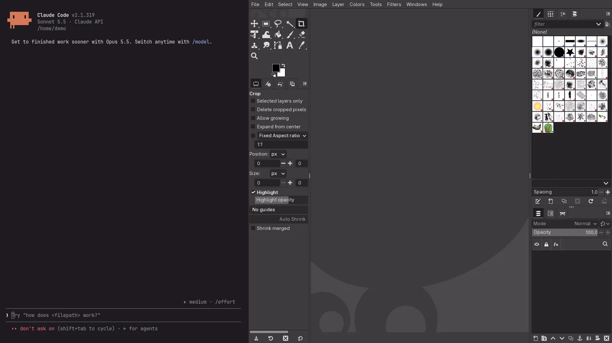

# gimp-mcp

<!-- mcp-name: io.github.mhbxyz/gimp-mcp -->

**Tell your AI assistant what you want, and watch it happen in GIMP.**
gimp-mcp connects Claude, Codex, Cursor, VS Code or any other [MCP](https://modelcontextprotocol.io) client to
the GIMP window you already have open: it opens files, builds layers, sets editable text, makes selections, applies
filters and exports, step by step, right in front of you.

[](https://pypi.org/project/gimp-mcp/)
[](https://pypi.org/project/gimp-mcp/)
[](https://github.com/mhbxyz/gimp-mcp/actions/workflows/ci.yml)
[](https://github.com/mhbxyz/gimp-mcp/blob/main/LICENSE)

<p align="center">
  <a href="https://github.com/mhbxyz/gimp-mcp/releases/download/v0.5.0/gimp-mcp-demo.mp4">
    
  </a>
  <br>
  <sub>A real, unedited session at 2× speed: one prompt in Claude Code, everything else done by GIMP through
  gimp-mcp. <a href="https://github.com/mhbxyz/gimp-mcp/releases/download/v0.5.0/gimp-mcp-demo.mp4">Full-quality video (1080p, real time)</a>.</sub>
</p>

## Quickstart

gimp-mcp runs on **Linux, macOS and Windows**. You need GIMP 3.2+, [uv](https://docs.astral.sh/uv/getting-started/installation/) and an MCP client. On Ubuntu 26.04:

<!-- doctest: quickstart -->
```sh
sudo apt install -y gimp python3-gi gir1.2-gimp-3.0   # GIMP 3.2+ (other distributions and Flatpak: see below)
uvx gimp-mcp setup                                    # installs the GIMP plug-in, adds the server to your MCP clients
uvx gimp-mcp doctor                                   # after (re)starting GIMP: every check should be [ok]
```

Then ask your assistant: *"Use GIMP to create a 1280×720 image with the title 'Hello' and export it to
~/hello.png"*.

* **macOS and Windows**: install GIMP 3.2 from [gimp.org](https://www.gimp.org/downloads/), then run the same
  `uvx gimp-mcp setup` and `uvx gimp-mcp doctor` ([install](https://github.com/mhbxyz/gimp-mcp/blob/main/docs/install.md)).
* Arch, Debian 14, Fedora 44, openSUSE Tumbleweed, Alpine 3.24 and GIMP from **Flathub**: see
  [compatibility](https://github.com/mhbxyz/gimp-mcp/blob/main/docs/compatibility.md#linux-distributions).
* Step by step for [Claude Code](https://github.com/mhbxyz/gimp-mcp/blob/main/docs/clients/claude-code.md),
  [Claude Desktop](https://github.com/mhbxyz/gimp-mcp/blob/main/docs/clients/claude-desktop.md),
  [VS Code and Cursor](https://github.com/mhbxyz/gimp-mcp/blob/main/docs/clients/vscode-cursor.md) and
  [any other MCP client](https://github.com/mhbxyz/gimp-mcp/blob/main/docs/clients/generic.md) (Codex, Zed…).
* Something wrong? `uvx gimp-mcp doctor` says what and how to fix it
  ([troubleshooting](https://github.com/mhbxyz/gimp-mcp/blob/main/docs/troubleshooting.md)).

## Why gimp-mcp

**Your GIMP, live.** The assistant works in the GIMP you have open, not in a hidden copy. Every layer it adds shows up
in the Layers panel, and you can take over with the mouse at any time.

**Results you can keep editing.** Titles stay editable text layers, each step can go on its own layer, blurs and color
corrections can be editable filters, and the XCF keeps all of it. The assistant gives you a starting point, not a
flattened PNG.

**It checks its own work.** Previews come back to the model as images, so it can see the result, fix what looks off and
only then export. Checkpoints let it try an idea and go back to an earlier state when it doesn't work out.

**Local and locked down.** No network port: one Unix socket that only you can open, a fresh token at every GIMP start,
a fixed set of operations, and an allowlist for the GIMP procedures it may call (no eval, no Script-Fu passthrough).
Details in the [security model](https://github.com/mhbxyz/gimp-mcp/blob/main/docs/security.md).

**Set up in one command.** `gimp-mcp setup` finds GIMP (distribution package or Flatpak), installs the plug-in and
adds the server to Claude Code, Claude Desktop, VS Code and Cursor, asking before it changes any file.

## Things to ask

* *"Open ~/Pictures/team.jpg, crop it to a centered square and export a 512 px avatar."*
* *"Make a 1200×630 social card for my blog post 'Shipping on Fridays', dark background, title on the left."*
* *"Brighten only the background layer of poster.xcf and keep the original underneath, hidden."*
* *"What's in ~/design/flyer.xcf? List the layers, the hidden ones and the fonts used."*
* *"Blur the license plate in car.jpg and save a copy next to it."*

## Use cases

Typical GIMP jobs done end to end through MCP, each with a scripted version checked in CI on Linux, macOS
and Windows, and an agent version (one plain-language request) in the evaluation suite:

* **Restore an old scanned photo**: straighten, crop the scanner bed, heal dust and scratches, restore
  contrast, reduce grain, 16-bit TIFF for print
  ([walk-through](https://github.com/mhbxyz/gimp-mcp/blob/main/docs/demos/old-photo-restoration.md)).
* **Product photo for an online store**: cut out without losing pixels, soft shadow on pure white,
  centered square, JPEG and WebP in three sizes with an sRGB profile
  ([walk-through](https://github.com/mhbxyz/gimp-mcp/blob/main/docs/demos/product-cutout.md)).
* **Social media kit**: one design in four formats (post, story, banner, thumbnail) with safe-area
  guides and an editable headline
  ([walk-through](https://github.com/mhbxyz/gimp-mcp/blob/main/docs/demos/social-media-kit.md)).
* **Tutorial screenshot**: callouts and arrows, private data pixelated beyond recovery, metadata
  removed ([walk-through](https://github.com/mhbxyz/gimp-mcp/blob/main/docs/demos/screenshot-annotation.md)).
* **Photos for a website**: a folder upright, resized, watermarked, GPS removed, WebP and JPEG, the
  corrupt file reported ([walk-through](https://github.com/mhbxyz/gimp-mcp/blob/main/docs/demos/web-photo-batch.md)).
* **Animated sticker**: frames with timing and disposal, optimized GIF and animated WebP under a size
  budget ([walk-through](https://github.com/mhbxyz/gimp-mcp/blob/main/docs/demos/animated-sticker.md)).
* **Print-ready flyer**: A5 at 300 dpi with bleed, trim and safe-margin guides, PDF and TIFF at print size
  ([walk-through](https://github.com/mhbxyz/gimp-mcp/blob/main/docs/demos/print-flyer.md)).
* **Sky replacement**: a new sky masked in, the foreground graded with an editable filter, no halo
  ([walk-through](https://github.com/mhbxyz/gimp-mcp/blob/main/docs/demos/sky-replacement.md)).
* **YouTube thumbnail** from one photo, with an editable title
  ([guide](https://github.com/mhbxyz/gimp-mcp/blob/main/docs/guide-thumbnail.md)).

## What it can do

| | |
|---|---|
| **Look** | list open images, inspect layer trees and items, render previews the model can see |
| **Files** | create, open, save XCF, export PNG and JPEG with options, close |
| **Layers** | add, import, duplicate, group, reorder, rename, opacity, blend modes, visibility |
| **Shape** | resize image or canvas, crop, scale, rotate, flip, move |
| **Select** | rectangles and ellipses (add, subtract, intersect, feather), invert, layer masks |
| **Paint** | fills, lines and paths, rectangles and ellipses |
| **Text** | editable text layers: font, size, color, alignment, spacing |
| **Adjust** | brightness/contrast, hue/saturation, blur, as destructive or editable filters |
| **History** | undo groups (one Ctrl+Z in GIMP) and checkpoints the assistant can restore |
| **Everything else** | about 420 more GIMP procedures, allowlisted (`procedures` toolset, opt-in) |

54 tools in all, grouped into [toolsets](https://github.com/mhbxyz/gimp-mcp/blob/main/docs/toolsets.md) so your client
only loads what it needs: see the [tool reference](https://github.com/mhbxyz/gimp-mcp/blob/main/docs/tools.md) and the
[coverage matrix](https://github.com/mhbxyz/gimp-mcp/blob/main/docs/coverage.md).

## How it works

```text
 Claude / Codex / Cursor / …            gimp-mcp serve                 GIMP 3.2
 ───────────────────────────  MCP   ─────────────────────  Unix   ─────────────────────────
  "make the colors pop"      stdio   validates, maps ids  socket   gimp-mcp-bridge plug-in
                            ──────▶  to GIMP operations  ──────▶   runs them in your session
```

`gimp-mcp setup` copies a small Python plug-in into your GIMP profile. GIMP starts it with the application, and it
serves its local socket while GIMP runs. The MCP server (`uvx gimp-mcp serve`, started by your client) talks to it.
Also works with a headless GIMP for scripts and CI. More in the
[architecture notes](https://github.com/mhbxyz/gimp-mcp/blob/main/docs/architecture.md).

## Documentation

- [Installation reference](https://github.com/mhbxyz/gimp-mcp/blob/main/docs/install.md) (manual install, upgrade, uninstall) ·
  [MCP clients](https://github.com/mhbxyz/gimp-mcp/blob/main/docs/clients.md) ·
  [troubleshooting](https://github.com/mhbxyz/gimp-mcp/blob/main/docs/troubleshooting.md) ·
  [compatibility](https://github.com/mhbxyz/gimp-mcp/blob/main/docs/compatibility.md)
- [Tool reference](https://github.com/mhbxyz/gimp-mcp/blob/main/docs/tools.md) ·
  [coverage matrix](https://github.com/mhbxyz/gimp-mcp/blob/main/docs/coverage.md) ·
  [scripted demo walk-through](https://github.com/mhbxyz/gimp-mcp/blob/main/docs/guide-thumbnail.md)
- [Architecture](https://github.com/mhbxyz/gimp-mcp/blob/main/docs/architecture.md) ·
  [bridge protocol](https://github.com/mhbxyz/gimp-mcp/blob/main/docs/bridge-protocol.md) ·
  [security](https://github.com/mhbxyz/gimp-mcp/blob/main/docs/security.md) ·
  [decisions](https://github.com/mhbxyz/gimp-mcp/tree/main/docs/adr)
- [Testing](https://github.com/mhbxyz/gimp-mcp/blob/main/docs/testing.md) ·
  [releasing](https://github.com/mhbxyz/gimp-mcp/blob/main/docs/releasing.md) ·
  [recording the demo video](https://github.com/mhbxyz/gimp-mcp/blob/main/demo/video/README.md) ·
  [GIMP behaviour notes](https://github.com/mhbxyz/gimp-mcp/blob/main/docs/gimp-notes.md) ·
  [changelog](https://github.com/mhbxyz/gimp-mcp/blob/main/CHANGELOG.md)

Also listed in the [official MCP registry](https://registry.modelcontextprotocol.io/v0/servers?search=io.github.mhbxyz/gimp-mcp)
as `io.github.mhbxyz/gimp-mcp`. MIT licensed.
