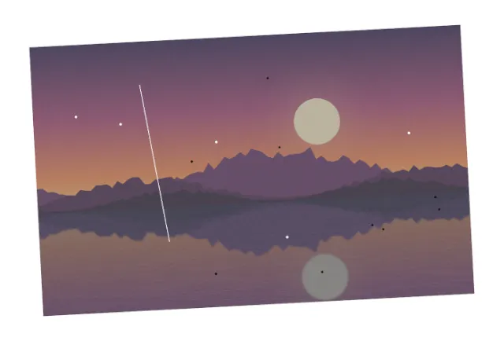
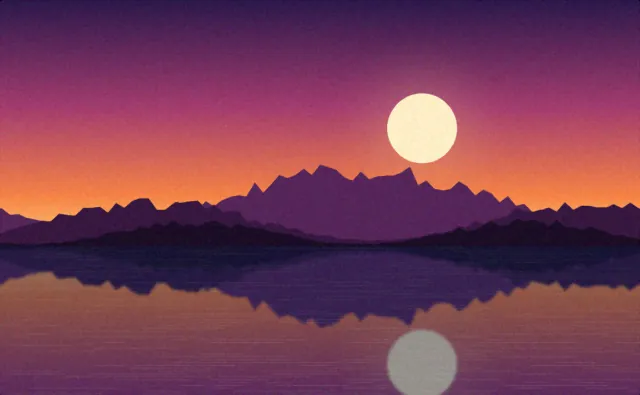

# Demo: restore an old scanned photo

A scan of an old print, tilted on the scanner, with the white scanner bed around it, dust, a
scratch, faded contrast and film grain, restored through MCP only, then exported as a 16-bit TIFF at
300 dpi for printing and a JPEG for the web.

```sh
uv run demo/run.py old-photo-restoration      # scripted version, headless GIMP; report in demo/out/
CLAUDE_CODE_OAUTH_TOKEN=... demo/video/record.sh 0.6.0 old-photo-restoration   # agent version, video
uv run evals/run.py old-photo-restoration     # agent version, checked (evaluation suite)
```

| Before (the scan) | After |
|---|---|
|  |  |

## How

1. `gimp_rotate_layer` by 3° (clockwise) undoes the tilt; `gimp_crop_image` keeps the print only.
2. `gimp_paint_stroke` with the **heal** tool on each dust spot (source 16 px to the right), and the
   **clone** tool along the scratch: a heal dab whose edge crosses the scratch brings it back.
3. `gimp_levels` maps the faded 60–187 range back to 0–255; `gimp_apply_filter`
   (`gegl:noise-reduction`) reduces the grain.
4. `gimp_convert_precision` (`u16-non-linear`), `gimp_set_print_size` (300 dpi), `gimp_export_as`
   (TIFF) and `gimp_export_image` (JPEG).

## What is checked

The scan is generated from `demo/assets/lake-sunset.png` (CC0) with known defects, so each check
compares with ground truth, never with taste: the sky's color bands (horizontal in the source) are
level within 0.4°; no near-white scanner bed remains on the edges; every dust spot and the scratch
have the clean print's color again (within 30/255); the histogram spans the full range again; the
grain of uniform sky rows is lower than on the scan; the TIFF is 16 bits per channel at 300 dpi and
the right size (read with Pillow). The [generated report](old-photo-restoration/report.md) lists every
tool call and every check.
