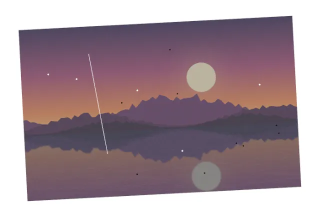

# gimp-mcp demo: restore an old scanned photo

Result: **PASS** — 13/13 checks, 31 MCP tool calls, 5.2 s.

Outputs: `scan.png`, `restored-print.tif`, `restored-web.jpg`.

## Previews (from `gimp_preview`)

**1. The scan: tilted, white bed, dust, a scratch, faded**

**2. Straightened and cropped**

**3. Dust healed, scratch cloned over**

**4. Contrast restored, noise reduced**

## Checks

| # | Check | Result | Detail |
|---|---|---|---|
| 1 | the scan is tilted (ground truth) | pass | 2.97° |
| 2 | the scan is faded (ground truth) | pass | 65-179 |
| 3 | the TIFF is 16 bits per channel | pass | (16, 16, 16, 16) |
| 4 | the TIFF is 1176x726 | pass | (1176, 726) |
| 5 | the TIFF says 300 dpi | pass | (300.0, 300.0) |
| 6 | the JPEG is 1176x726 | pass | (1176, 726) |
| 7 | the sky's color bands are level (tilt under 0.4° measured) | pass | -0.22° |
| 8 | no scanner bed remains along the edges | pass | 0 near-white edge pixels |
| 9 | every dust spot has the clean print's color again (within 30) | pass | worst 10/255; the spots were 33-215 away |
| 10 | the scratch has the clean print's color again (within 30) | pass | worst 12/255 over 18 of 19 points |
| 11 | the histogram spans the full range again (1%-99%: <=25 and >=230) | pass | 18-237, scan 65-179 |
| 12 | noise is reduced in flat sky rows | pass | row std dev 2.5, scan 4.0 (x2 after levels without reduction) |
| 13 | the server listed only the scenario's toolsets (63 tools) | pass | files,layers,transform,painting,color,effects,modes,formats,document |

## Tool calls

| # | Tool | Arguments | ms | Result |
|---|---|---|---|---|
| 1 | `gimp_open_image` | `{"path": "demo/out/old-photo-restoration/scan.png"}` | 187 | id=image:1@eeb257c8, name=[scan] (imported), width=1400, height=950 |
| 2 | `gimp_inspect_image` | `{"image": "image:1@eeb257c8"}` | 13 | id=image:1@eeb257c8, name=[scan] (imported), width=1400, height=950 |
| 3 | `gimp_preview` | `{"image": "image:1@eeb257c8", "max_size": 640}` | 118 | 640x434 PNG, 350937 bytes |
| 4 | `gimp_rotate_layer` | `{"item": "item:2@eeb257c8", "angle": 3.0, "clip": "clip"}` | 128 | id=item:2@eeb257c8, name=Background, kind=layer, width=1400, height=950, x=0, y=0 |
| 5 | `gimp_crop_image` | `{"image": "image:1@eeb257c8", "x": 112, "y": 112, "width": 1176, "height": 726}` | 10 | width=1176, height=726 |
| 6 | `gimp_preview` | `{"image": "image:1@eeb257c8", "max_size": 640}` | 118 | 640x395 PNG, 497934 bytes |
| 7 | `gimp_enable_toolsets` | `{"toolsets": ["painting", "color", "effects", "modes", "formats", "document"]}` | 3 | ok |
| 8 | `gimp_paint_stroke` | `{"item": "item:2@eeb257c8", "tool": "heal", "points": [[230, 215]], "size": 15, "hardness": 1.0, "source": "item:2@ee...` | 18 | ok |
| 9 | `gimp_paint_stroke` | `{"item": "item:2@eeb257c8", "tool": "heal", "points": [[914, 532]], "size": 15, "hardness": 1.0, "source": "item:2@ee...` | 7 | ok |
| 10 | `gimp_paint_stroke` | `{"item": "item:2@eeb257c8", "tool": "heal", "points": [[768, 655]], "size": 15, "hardness": 1.0, "source": "item:2@ee...` | 6 | ok |
| 11 | `gimp_paint_stroke` | `{"item": "item:2@eeb257c8", "tool": "heal", "points": [[493, 278]], "size": 15, "hardness": 1.0, "source": "item:2@ee...` | 6 | ok |
| 12 | `gimp_paint_stroke` | `{"item": "item:2@eeb257c8", "tool": "heal", "points": [[473, 645]], "size": 15, "hardness": 1.0, "source": "item:2@ee...` | 7 | ok |
| 13 | `gimp_paint_stroke` | `{"item": "item:2@eeb257c8", "tool": "heal", "points": [[1093, 463]], "size": 15, "hardness": 1.0, "source": "item:2@e...` | 7 | ok |
| 14 | `gimp_paint_stroke` | `{"item": "item:2@eeb257c8", "tool": "heal", "points": [[1029, 281]], "size": 15, "hardness": 1.0, "source": "item:2@e...` | 6 | ok |
| 15 | `gimp_paint_stroke` | `{"item": "item:2@eeb257c8", "tool": "heal", "points": [[944, 545]], "size": 15, "hardness": 1.0, "source": "item:2@ee...` | 6 | ok |
| 16 | `gimp_paint_stroke` | `{"item": "item:2@eeb257c8", "tool": "heal", "points": [[422, 329]], "size": 15, "hardness": 1.0, "source": "item:2@ee...` | 7 | ok |
| 17 | `gimp_paint_stroke` | `{"item": "item:2@eeb257c8", "tool": "heal", "points": [[107, 188]], "size": 15, "hardness": 1.0, "source": "item:2@ee...` | 8 | ok |
| 18 | `gimp_paint_stroke` | `{"item": "item:2@eeb257c8", "tool": "heal", "points": [[668, 302]], "size": 15, "hardness": 1.0, "source": "item:2@ee...` | 6 | ok |
| 19 | `gimp_paint_stroke` | `{"item": "item:2@eeb257c8", "tool": "heal", "points": [[1102, 498]], "size": 15, "hardness": 1.0, "source": "item:2@e...` | 6 | ok |
| 20 | `gimp_paint_stroke` | `{"item": "item:2@eeb257c8", "tool": "heal", "points": [[676, 553]], "size": 15, "hardness": 1.0, "source": "item:2@ee...` | 7 | ok |
| 21 | `gimp_paint_stroke` | `{"item": "item:2@eeb257c8", "tool": "heal", "points": [[645, 108]], "size": 15, "hardness": 1.0, "source": "item:2@ee...` | 6 | ok |
| 22 | `gimp_paint_stroke` | `{"item": "item:2@eeb257c8", "tool": "clone", "points": [[288, 108], [348, 548]], "size": 9, "hardness": 1.0, "spacing...` | 12 | ok |
| 23 | `gimp_preview` | `{"image": "image:1@eeb257c8", "max_size": 640}` | 121 | 640x395 PNG, 493725 bytes |
| 24 | `gimp_levels` | `{"item": "item:2@eeb257c8", "input_low": 60, "input_high": 187}` | 11 | destructive=False, filter=filter:1@eeb257c8 |
| 25 | `gimp_apply_filter` | `{"item": "item:2@eeb257c8", "operation": "gegl:noise-reduction", "parameters": {"iterations": 3}, "destructive": true}` | 1967 | destructive=True, filter={'id': None, 'name': 'Noise Reduction', 'operation': 'gegl:noise-reduction', 'visible': True, 'opacity': 100.0, 'mode': 'replace', 'par |
| 26 | `gimp_preview` | `{"image": "image:1@eeb257c8", "max_size": 640}` | 121 | 640x395 PNG, 492489 bytes |
| 27 | `gimp_convert_precision` | `{"image": "image:1@eeb257c8", "precision": "u16-non-linear"}` | 55 | changed=True |
| 28 | `gimp_set_print_size` | `{"image": "image:1@eeb257c8", "x_resolution": 300, "y_resolution": 300}` | 46 | ok |
| 29 | `gimp_export_as` | `{"image": "image:1@eeb257c8", "path": "demo/out/old-photo-restoration/restored-pri...` | 158 | path=demo/out/old-photo-restoration/restored-print.tif, bytes=6830517 |
| 30 | `gimp_export_image` | `{"image": "image:1@eeb257c8", "path": "demo/out/old-photo-restoration/restored-web...` | 222 | width=1176, height=726, path=demo/out/old-photo-restoration/restored-web.jpg, bytes=221830 |
| 31 | `gimp_close_image` | `{"image": "image:1@eeb257c8", "discard_changes": true}` | 7 | ok |
