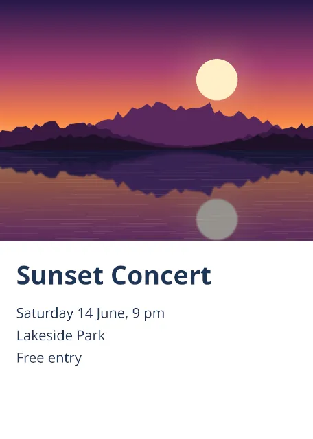

# gimp-mcp demo: print-ready A5 flyer

Result: **PASS** — 9/9 checks, 26 MCP tool calls, 2.5 s.

Outputs: `flyer.xcf`, `flyer.pdf`, `flyer.tif`.

## Previews (from `gimp_preview`)

**The flyer (bleed and safe-area guides not printed)**

## Checks

| # | Check | Result | Detail |
|---|---|---|---|
| 1 | the photo reaches the bleed edges (left, top, right) | pass | -213,0 2245x1403 |
| 2 | the title lies inside the safe area | pass | 94,1493 1631x210, safe margin 94 px |
| 3 | the body lies inside the safe area | pass | 94,1763 1631x420, safe margin 94 px |
| 4 | guides on the trim and the safe margins | pass | [('horizontal', 35), ('horizontal', 94), ('horizontal', 2457), ('horizontal', 2516), ('vertical', 35), ('vertical', 94), ('vertical', 1725), ('vertical', 1784)] |
| 5 | the PDF page is 154x216 mm (A5 with 3 mm bleed) | pass | 436.6 x 612.2 pt, expected 436.5 x 612.3 |
| 6 | the TIFF is 1819x2551 at 300 dpi | pass | (1819, 2551), (300.0, 300.0) |
| 7 | the photo is printed up to the bleed edge (no white on the top and left edges) | pass | 0 white samples |
| 8 | the XCF keeps guides on the trim and the safe margins | pass | [('horizontal', 35), ('horizontal', 94), ('horizontal', 2457), ('horizontal', 2516), ('vertical', 35), ('vertical', 94), ('vertical', 1725), ('vertical', 1784)] |
| 9 | the server listed only the scenario's toolsets (52 tools) | pass | files,layers,transform,text,document,formats,compose |

## Tool calls

| # | Tool | Arguments | ms | Result |
|---|---|---|---|---|
| 1 | `gimp_create_image` | `{"width": 1819, "height": 2551, "fill": "#ffffff"}` | 94 | id=image:1@8726e5f8, name=[Untitled], width=1819, height=2551 |
| 2 | `gimp_enable_toolsets` | `{"toolsets": ["document", "formats", "compose"]}` | 3 | ok |
| 3 | `gimp_set_print_size` | `{"image": "image:1@8726e5f8", "x_resolution": 300, "y_resolution": 300}` | 4 | ok |
| 4 | `gimp_add_guide` | `{"image": "image:1@8726e5f8", "orientation": "horizontal", "position": 35}` | 7 | ok |
| 5 | `gimp_add_guide` | `{"image": "image:1@8726e5f8", "orientation": "horizontal", "position": 94}` | 3 | ok |
| 6 | `gimp_add_guide` | `{"image": "image:1@8726e5f8", "orientation": "horizontal", "position": 2457}` | 3 | ok |
| 7 | `gimp_add_guide` | `{"image": "image:1@8726e5f8", "orientation": "horizontal", "position": 2516}` | 2 | ok |
| 8 | `gimp_add_guide` | `{"image": "image:1@8726e5f8", "orientation": "vertical", "position": 35}` | 3 | ok |
| 9 | `gimp_add_guide` | `{"image": "image:1@8726e5f8", "orientation": "vertical", "position": 94}` | 3 | ok |
| 10 | `gimp_add_guide` | `{"image": "image:1@8726e5f8", "orientation": "vertical", "position": 1725}` | 3 | ok |
| 11 | `gimp_add_guide` | `{"image": "image:1@8726e5f8", "orientation": "vertical", "position": 1784}` | 3 | ok |
| 12 | `gimp_import_layer` | `{"image": "image:1@8726e5f8", "path": "demo/assets/lake-sunset.png", "name": "Photo"}` | 120 | id=item:5@8726e5f8, name=Photo, kind=layer, width=1600, height=1000, x=0, y=0 |
| 13 | `gimp_scale_layer` | `{"item": "item:5@8726e5f8", "width": 2245, "height": 1403, "anchor": "top-left"}` | 88 | id=item:5@8726e5f8, name=Photo, kind=layer, width=2245, height=1403, x=0, y=0 |
| 14 | `gimp_set_layer_offsets` | `{"item": "item:5@8726e5f8", "x": -213, "y": 0}` | 12 | id=item:5@8726e5f8, name=Photo, kind=layer, width=2245, height=1403, x=-213, y=0 |
| 15 | `gimp_create_text_layer` | `{"image": "image:1@8726e5f8", "text": "Sunset Concert", "font": "Sans-serif Bold", "size": 150, "color": "#1d3557", "...` | 85 | id=item:6@8726e5f8, name=Sunset Concert, kind=text, width=1631, height=210, x=94, y=1493 |
| 16 | `gimp_set_layer_properties` | `{"item": "item:6@8726e5f8", "name": "Title"}` | 12 | id=item:6@8726e5f8, name=Title, kind=text, width=1631, height=210, x=94, y=1493 |
| 17 | `gimp_create_text_layer` | `{"image": "image:1@8726e5f8", "text": "Saturday 14 June, 9 pm\nLakeside Park\nFree entry", "font": "Sans-serif", "siz...` | 36 | id=item:7@8726e5f8, name=Saturday 14 June, 9 pm ..., kind=text, width=1631, height=420, x=94, y=1763 |
| 18 | `gimp_set_layer_properties` | `{"item": "item:7@8726e5f8", "name": "Body"}` | 10 | id=item:7@8726e5f8, name=Body, kind=text, width=1631, height=420, x=94, y=1763 |
| 19 | `gimp_preview` | `{"image": "image:1@8726e5f8", "max_size": 640}` | 42 | 456x640 PNG, 54423 bytes |
| 20 | `gimp_inspect_image` | `{"image": "image:1@8726e5f8"}` | 15 | id=image:1@8726e5f8, name=[Untitled], width=1819, height=2551 |
| 21 | `gimp_list_guides` | `{"image": "image:1@8726e5f8"}` | 7 | ok |
| 22 | `gimp_save_image` | `{"image": "image:1@8726e5f8", "path": "demo/out/print-flyer/flyer.xcf", "overwrite...` | 36 | bytes=664683 |
| 23 | `gimp_flatten_image` | `{"image": "image:1@8726e5f8"}` | 107 | ok |
| 24 | `gimp_export_as` | `{"image": "image:1@8726e5f8", "path": "demo/out/print-flyer/flyer.pdf", "overwrite...` | 708 | path=demo/out/print-flyer/flyer.pdf, bytes=316439 |
| 25 | `gimp_export_as` | `{"image": "image:1@8726e5f8", "path": "demo/out/print-flyer/flyer.tif", "overwrite...` | 200 | path=demo/out/print-flyer/flyer.tif, bytes=13921213 |
| 26 | `gimp_close_image` | `{"image": "image:1@8726e5f8", "discard_changes": true}` | 6 | ok |
