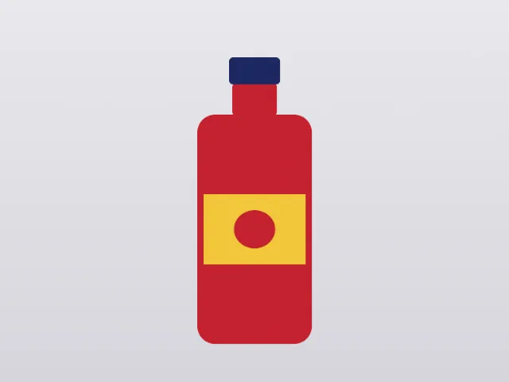
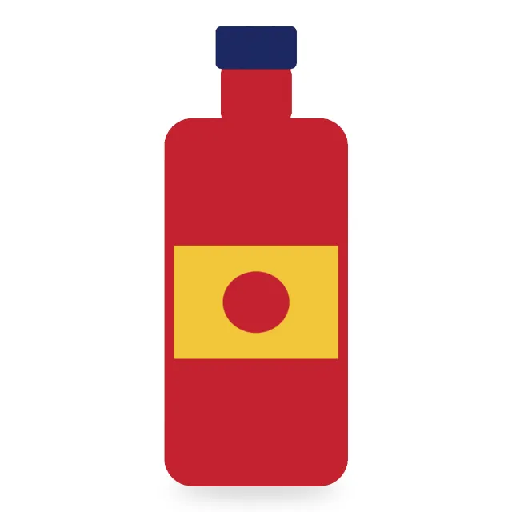

# Demo: product photo cut-out for an online store

A studio shot of a bottle on a light-gray sweep, cut out without losing the original pixels, put on
pure white with a soft contact shadow, centered on a 2000×2000 square with a 5% margin, and exported
as JPEG and WebP with an sRGB profile at 2000, 800 and 400 px, through MCP only.

```sh
uv run demo/run.py product-cutout      # scripted version, headless GIMP; report in demo/out/
CLAUDE_CODE_OAUTH_TOKEN=... demo/video/record.sh 0.6.0 product-cutout   # agent version, video
uv run evals/run.py product-cutout     # agent version, checked (evaluation suite)
```

| Before (the shot) | After |
|---|---|
|  |  |

## How

1. `gimp_resize_image` and `gimp_resize_canvas` put the bottle at its final size and place first, so
   the cut-out is made at the final resolution.
2. `gimp_select_by_color` from a corner of the backdrop (fuzzy select), `gimp_modify_selection`
   `invert`, `gimp_modify_selection_shape` `shrink` 2 px and `feather` 1 px, then
   `gimp_add_layer_mask` from the selection: the backdrop is hidden, not erased.
3. A "Shadow" layer: an ellipse under the bottle filled with black, blurred, at 45% opacity; a
   "White" layer below everything.
4. An sRGB ICC file is assigned (assigning GIMP's built-in sRGB changes nothing, so nothing would be
   embedded: #158), the XCF is saved, and each size is exported with `gimp_export_image` (JPEG,
   `color_profile`) and `gimp_export_as` (lossless WebP).

## What is checked

The shot is drawn by code (CC0), so the bottle's box is known. Every export has its size and an sRGB
profile (read with Pillow and LittleCMS); the bottle's saturated pixels are centered within 20 px and
their largest side is 1800 px (5% margins); outside the bottle and its shadow every pixel is exactly
`#ffffff`; the shadow is darker than white right below the bottle and absent above it; the reopened
XCF still has the backdrop's pixels under the mask. The [generated report](product-cutout/report.md)
lists every tool call and check.
