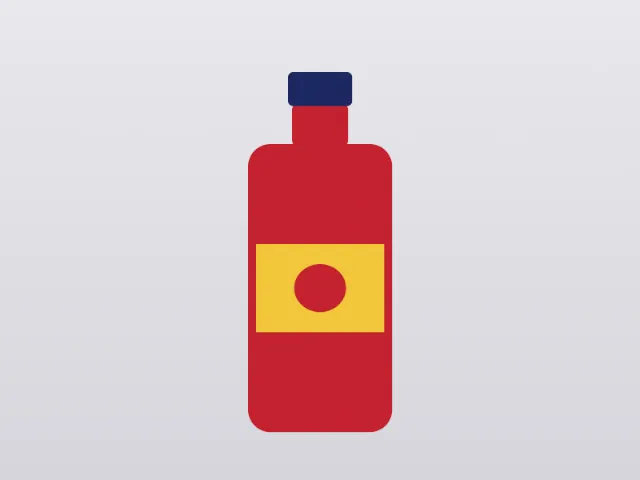
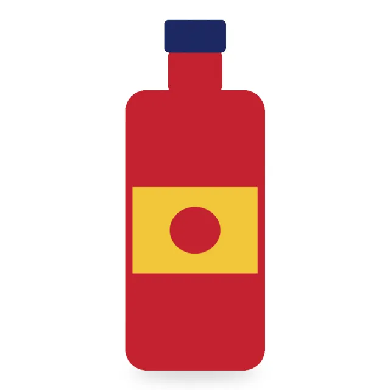

# gimp-mcp demo: product photo cut-out for an online store

Result: **PASS** — 12/12 checks, 36 MCP tool calls, 5.9 s.

Outputs: `shot.png`, `product.xcf`, `product-2000.jpg`, `product-2000.webp`, `product-800.jpg`, `product-800.webp`, `product-400.jpg`, `product-400.webp`.

## Previews (from `gimp_preview`)

**1. The studio shot**

**2. Cut out, centered with a 5% margin, soft shadow on white**

## Checks

| # | Check | Result | Detail |
|---|---|---|---|
| 1 | the cut-out is a layer mask (non-destructive) | pass |  |
| 2 | the XCF keeps the backdrop pixels under the mask | pass | layer pixel at [30, 30]: [231, 231, 235, 255] |
| 3 | product-2000.jpg is 2000x2000 with an sRGB profile | pass | (2000, 2000), profile sRGB built-in |
| 4 | product-2000.webp is 2000x2000 with an sRGB profile | pass | (2000, 2000), profile sRGB built-in |
| 5 | product-800.jpg is 800x800 with an sRGB profile | pass | (800, 800), profile sRGB built-in |
| 6 | product-800.webp is 800x800 with an sRGB profile | pass | (800, 800), profile sRGB built-in |
| 7 | product-400.jpg is 400x400 with an sRGB profile | pass | (400, 400), profile sRGB built-in |
| 8 | product-400.webp is 400x400 with an sRGB profile | pass | (400, 400), profile sRGB built-in |
| 9 | the product is centered with a 5% margin | pass | box (642, 102, 1360, 1900), center 1001,1001, largest side 1798 (target 1800) |
| 10 | outside the product and its shadow, pixels are exactly white | pass | 0 other pixels |
| 11 | a soft shadow lies below the product, none above it | pass | darkest below 221, above 255 |
| 12 | the server listed only the scenario's toolsets (62 tools) | pass | files,layers,transform,selection,paint,filters,channels,formats,modes,analysis |

## Tool calls

| # | Tool | Arguments | ms | Result |
|---|---|---|---|---|
| 1 | `gimp_open_image` | `{"path": "demo/out/product-cutout/shot.png"}` | 224 | id=image:1@32a61195, name=[shot] (imported), width=1600, height=1200 |
| 2 | `gimp_enable_toolsets` | `{"toolsets": ["channels", "formats", "modes", "analysis"]}` | 2 | ok |
| 3 | `gimp_preview` | `{"image": "image:1@32a61195", "max_size": 640}` | 90 | 640x480 PNG, 176748 bytes |
| 4 | `gimp_resize_image` | `{"image": "image:1@32a61195", "width": 3200, "height": 2400}` | 156 | width=3200, height=2400 |
| 5 | `gimp_resize_canvas` | `{"image": "image:1@32a61195", "width": 2000, "height": 2000, "offset_x": -600, "offset_y": -260}` | 5 | width=2000, height=2000 |
| 6 | `gimp_inspect_image` | `{"image": "image:1@32a61195"}` | 17 | id=image:1@32a61195, name=[shot] (imported), width=2000, height=2000 |
| 7 | `gimp_set_layer_properties` | `{"item": "item:2@32a61195", "name": "Product"}` | 12 | id=item:2@32a61195, name=Product, kind=layer, width=3200, height=2400, x=-600, y=-260 |
| 8 | `gimp_select_by_color` | `{"image": "image:1@32a61195", "point": [20, 20], "item": "item:2@32a61195", "threshold": 40}` | 158 | ok |
| 9 | `gimp_modify_selection` | `{"image": "image:1@32a61195", "action": "invert"}` | 9 | ok |
| 10 | `gimp_modify_selection_shape` | `{"image": "image:1@32a61195", "action": "shrink", "amount": 2}` | 19 | ok |
| 11 | `gimp_modify_selection_shape` | `{"image": "image:1@32a61195", "action": "feather", "amount": 1}` | 21 | ok |
| 12 | `gimp_add_layer_mask` | `{"item": "item:2@32a61195", "fill": "selection"}` | 20 | id=item:2@32a61195, name=Product, kind=layer, width=3200, height=2400, x=-600, y=-260 |
| 13 | `gimp_modify_selection` | `{"image": "image:1@32a61195", "action": "none"}` | 9 | ok |
| 14 | `gimp_create_layer` | `{"image": "image:1@32a61195", "name": "Shadow", "position": 1}` | 19 | id=item:4@32a61195, name=Shadow, kind=layer, width=2000, height=2000, x=0, y=0 |
| 15 | `gimp_select_ellipse` | `{"image": "image:1@32a61195", "x": 680, "y": 1870, "width": 640, "height": 70}` | 8 | ok |
| 16 | `gimp_fill` | `{"item": "item:4@32a61195", "color": "#000000"}` | 13 | changed=True |
| 17 | `gimp_modify_selection` | `{"image": "image:1@32a61195", "action": "none"}` | 13 | ok |
| 18 | `gimp_gaussian_blur` | `{"item": "item:4@32a61195", "radius": 40}` | 114 | destructive=True |
| 19 | `gimp_set_layer_properties` | `{"item": "item:4@32a61195", "opacity": 45}` | 16 | id=item:4@32a61195, name=Shadow, kind=layer, width=2000, height=2000, x=0, y=0 |
| 20 | `gimp_create_layer` | `{"image": "image:1@32a61195", "name": "White", "position": 2, "fill": "white"}` | 27 | id=item:6@32a61195, name=White, kind=layer, width=2000, height=2000, x=0, y=0 |
| 21 | `gimp_set_color_profile` | `{"image": "image:1@32a61195", "action": "assign", "profile": "file", "path": "/home/mhbxyz/Projects/gimp-mcp-109/demo...` | 31 | ok |
| 22 | `gimp_preview` | `{"image": "image:1@32a61195", "max_size": 640}` | 63 | 640x640 PNG, 113076 bytes |
| 23 | `gimp_save_image` | `{"image": "image:1@32a61195", "path": "demo/out/product-cutout/product.xcf", "over...` | 100 | bytes=18379192 |
| 24 | `gimp_export_image` | `{"image": "image:1@32a61195", "path": "demo/out/product-cutout/product-2000.jpg", ...` | 255 | width=2000, height=2000, path=demo/out/product-cutout/product-2000.jpg, bytes=151991 |
| 25 | `gimp_export_as` | `{"image": "image:1@32a61195", "path": "demo/out/product-cutout/product-2000.webp",...` | 979 | path=demo/out/product-cutout/product-2000.webp, bytes=324068 |
| 26 | `gimp_resize_image` | `{"image": "image:1@32a61195", "width": 800, "height": 800}` | 577 | width=800, height=800 |
| 27 | `gimp_export_image` | `{"image": "image:1@32a61195", "path": "demo/out/product-cutout/product-800.jpg", "...` | 123 | width=800, height=800, path=demo/out/product-cutout/product-800.jpg, bytes=28419 |
| 28 | `gimp_export_as` | `{"image": "image:1@32a61195", "path": "demo/out/product-cutout/product-800.webp", ...` | 296 | path=demo/out/product-cutout/product-800.webp, bytes=65996 |
| 29 | `gimp_resize_image` | `{"image": "image:1@32a61195", "width": 400, "height": 400}` | 155 | width=400, height=400 |
| 30 | `gimp_export_image` | `{"image": "image:1@32a61195", "path": "demo/out/product-cutout/product-400.jpg", "...` | 121 | width=400, height=400, path=demo/out/product-cutout/product-400.jpg, bytes=9950 |
| 31 | `gimp_export_as` | `{"image": "image:1@32a61195", "path": "demo/out/product-cutout/product-400.webp", ...` | 207 | path=demo/out/product-cutout/product-400.webp, bytes=16986 |
| 32 | `gimp_close_image` | `{"image": "image:1@32a61195", "discard_changes": true}` | 8 | ok |
| 33 | `gimp_open_image` | `{"path": "demo/out/product-cutout/product.xcf"}` | 99 | id=image:8@32a61195, name=product.xcf, width=2000, height=2000 |
| 34 | `gimp_inspect_image` | `{"image": "image:8@32a61195"}` | 32 | id=image:8@32a61195, name=product.xcf, width=2000, height=2000 |
| 35 | `gimp_sample_colors` | `{"target": "item:86@32a61195", "points": [[30, 30]], "radius": 2}` | 148 | ok |
| 36 | `gimp_close_image` | `{"image": "image:8@32a61195"}` | 11 | ok |
