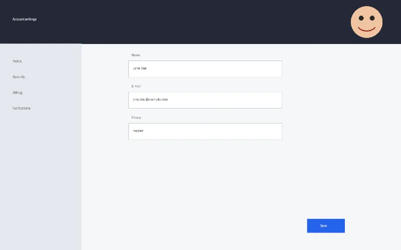
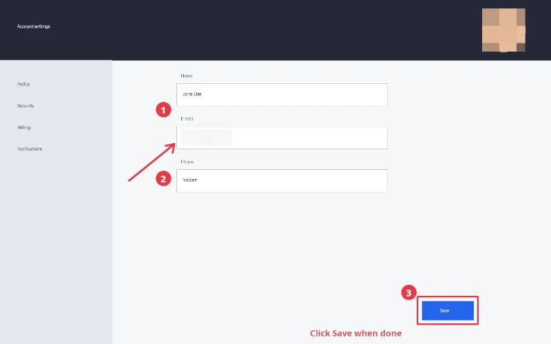

# Demo: annotate a screenshot and redact private data

An application screenshot made into a tutorial image: a red box around the Save button, an arrow to
the e-mail field, numbered callouts and a label; the e-mail address and the avatar pixelated beyond
recovery; exported as a lossless PNG without any metadata, through MCP only.

```sh
uv run demo/run.py screenshot-annotation      # scripted version, headless GIMP; report in demo/out/
CLAUDE_CODE_OAUTH_TOKEN=... demo/video/record.sh 0.6.0 screenshot-annotation   # agent version, video
uv run evals/run.py screenshot-annotation     # agent version, checked (evaluation suite)
```

| Before | After |
|---|---|
|  |  |

## How

1. For the e-mail and the avatar: `gimp_select_rectangle`, then `gimp_apply_filter` with
   `gegl:pixelize` in 40 px blocks (larger than a line of text), limited to the selection.
2. An "Annotations" layer: `gimp_draw_shape` (box outline, callout discs), `gimp_draw_path` (arrow and
   its head), `gimp_create_text_layer` (numbers and label).
3. `gimp_export_as` to PNG with `time: false`: `gimp_export_image` writes the export time in a `tIME`
   chunk (#160).

## What is checked

The screenshot is drawn by code (CC0) with a planted author/software text chunk, so every input pixel
is known: the redacted regions are flat blocks with none of their dark pixels (glyphs, eyes) left;
the box, arrow and callouts are red where they were drawn, the callouts hold a white number; every
pixel that changed is in a redaction or next to a red annotation; the PNG has no text, Exif, time or
profile chunk (read with the standard library). The [generated report](screenshot-annotation/report.md)
lists every call and check.
