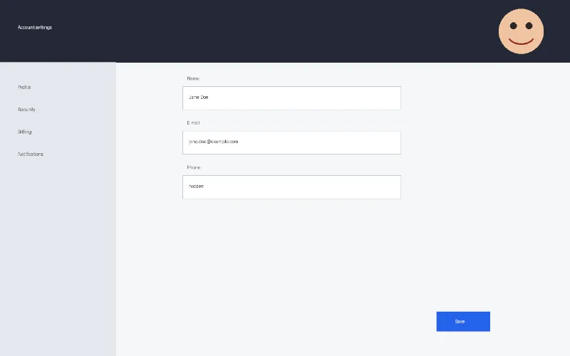
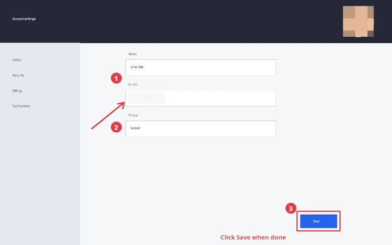

# gimp-mcp demo: annotate a screenshot and redact private data

Result: **PASS** — 10/10 checks, 24 MCP tool calls, 3.3 s.

Outputs: `screenshot.png`, `tutorial.png`.

## Previews (from `gimp_preview`)

**1. The screenshot**

**2. Annotated, e-mail and avatar pixelated**

## Checks

| # | Check | Result | Detail |
|---|---|---|---|
| 1 | tutorial.png is a lossless PNG of the same size | pass | PNG (1280, 800) |
| 2 | the e-mail keeps no detail (no glyph pixel left) | pass | dark pixels 0 (were 229) |
| 3 | the avatar keeps no detail (flatter, eyes and mouth gone) | pass | std dev 23.6 (was 71.4), features still visible at [] |
| 4 | a red box around the Save button | pass | (230, 57, 70) |
| 5 | a red arrow to the e-mail field | pass | (230, 57, 70) |
| 6 | three red callouts with a white number | pass | [True, True, True] |
| 7 | outside the annotations and redactions, pixels are identical to the screenshot | pass | 0 other changed pixels |
| 8 | red annotations at the Save button, the E-mail field, the Name and Phone fields | pass | red pixels: save 2334, e-mail 1903, name 895, phone 1211 |
| 9 | the PNG carries no metadata (no text, Exif, time or profile chunk) | pass | chunks ['IHDR', 'sRGB', 'gAMA', 'cHRM', 'bKGD', 'pHYs', 'IDAT', 'IDAT', 'IDAT', 'IEND'] |
| 10 | the server listed only the scenario's toolsets (45 tools) | pass | files,layers,selection,paint,text,effects,formats |

## Tool calls

| # | Tool | Arguments | ms | Result |
|---|---|---|---|---|
| 1 | `gimp_open_image` | `{"path": "demo/out/screenshot-annotation/screenshot.png"}` | 183 | id=image:1@d8d282f0, name=[screenshot] (imported), width=1280, height=800 |
| 2 | `gimp_inspect_image` | `{"image": "image:1@d8d282f0"}` | 14 | id=image:1@d8d282f0, name=[screenshot] (imported), width=1280, height=800 |
| 3 | `gimp_enable_toolsets` | `{"toolsets": ["effects"]}` | 3 | ok |
| 4 | `gimp_preview` | `{"image": "image:1@d8d282f0", "max_size": 800}` | 36 | 800x500 PNG, 10674 bytes |
| 5 | `gimp_select_rectangle` | `{"image": "image:1@d8d282f0", "x": 420, "y": 300, "width": 340, "height": 40}` | 11 | ok |
| 6 | `gimp_apply_filter` | `{"item": "item:2@d8d282f0", "operation": "gegl:pixelize", "destructive": true, "parameters": {"size-x": 40, "size-y":...` | 576 | destructive=True, filter={'id': None, 'name': 'Pixelize', 'operation': 'gegl:pixelize', 'visible': True, 'opacity': 100.0, 'mode': 'replace', 'parameters': {'no |
| 7 | `gimp_select_rectangle` | `{"image": "image:1@d8d282f0", "x": 1120, "y": 20, "width": 100, "height": 100}` | 6 | ok |
| 8 | `gimp_apply_filter` | `{"item": "item:2@d8d282f0", "operation": "gegl:pixelize", "destructive": true, "parameters": {"size-x": 40, "size-y":...` | 11 | destructive=True, filter={'id': None, 'name': 'Pixelize', 'operation': 'gegl:pixelize', 'visible': True, 'opacity': 100.0, 'mode': 'replace', 'parameters': {'no |
| 9 | `gimp_modify_selection` | `{"image": "image:1@d8d282f0", "action": "none"}` | 4 | ok |
| 10 | `gimp_create_layer` | `{"image": "image:1@d8d282f0", "name": "Annotations"}` | 11 | id=item:7@d8d282f0, name=Annotations, kind=layer, width=1280, height=800, x=0, y=0 |
| 11 | `gimp_draw_shape` | `{"item": "item:7@d8d282f0", "shape": "rectangle", "x": 970, "y": 690, "width": 140, "height": 64, "stroke_color": "#e...` | 23 | changed=True |
| 12 | `gimp_draw_path` | `{"item": "item:7@d8d282f0", "points": [[300, 420], [405, 335]], "color": "#e63946", "width": 5}` | 30 | changed=True |
| 13 | `gimp_draw_path` | `{"item": "item:7@d8d282f0", "points": [[385, 339], [405, 335], [401, 355]], "color": "#e63946", "width": 5}` | 26 | changed=True |
| 14 | `gimp_draw_shape` | `{"item": "item:7@d8d282f0", "shape": "ellipse", "x": 362, "y": 237, "width": 36, "height": 36, "fill_color": "#e63946"}` | 13 | changed=True |
| 15 | `gimp_create_text_layer` | `{"image": "image:1@d8d282f0", "text": "1", "font": "Sans-serif Bold", "size": 22, "color": "#ffffff", "x": 362, "y": ...` | 65 | id=item:12@d8d282f0, name=1, kind=text, width=36, height=30, x=362, y=240 |
| 16 | `gimp_draw_shape` | `{"item": "item:7@d8d282f0", "shape": "ellipse", "x": 362, "y": 397, "width": 36, "height": 36, "fill_color": "#e63946"}` | 10 | changed=True |
| 17 | `gimp_create_text_layer` | `{"image": "image:1@d8d282f0", "text": "2", "font": "Sans-serif Bold", "size": 22, "color": "#ffffff", "x": 362, "y": ...` | 10 | id=item:13@d8d282f0, name=2, kind=text, width=36, height=30, x=362, y=400 |
| 18 | `gimp_draw_shape` | `{"item": "item:7@d8d282f0", "shape": "ellipse", "x": 932, "y": 662, "width": 36, "height": 36, "fill_color": "#e63946"}` | 8 | changed=True |
| 19 | `gimp_create_text_layer` | `{"image": "image:1@d8d282f0", "text": "3", "font": "Sans-serif Bold", "size": 22, "color": "#ffffff", "x": 932, "y": ...` | 10 | id=item:14@d8d282f0, name=3, kind=text, width=36, height=30, x=932, y=665 |
| 20 | `gimp_create_text_layer` | `{"image": "image:1@d8d282f0", "text": "Click Save when done", "font": "Sans-serif Bold", "size": 20, "color": "#e6394...` | 10 | id=item:15@d8d282f0, name=Click Save when done, kind=text, width=250, height=30, x=720, y=760 |
| 21 | `gimp_preview` | `{"image": "image:1@d8d282f0", "max_size": 800}` | 14 | 800x500 PNG, 15147 bytes |
| 22 | `gimp_enable_toolsets` | `{"toolsets": ["formats"]}` | 1 | ok |
| 23 | `gimp_export_as` | `{"image": "image:1@d8d282f0", "path": "demo/out/screenshot-annotation/tutorial.png...` | 304 | path=demo/out/screenshot-annotation/tutorial.png, bytes=22662 |
| 24 | `gimp_close_image` | `{"image": "image:1@d8d282f0", "discard_changes": true}` | 7 | ok |
