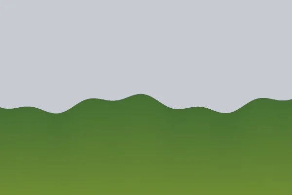
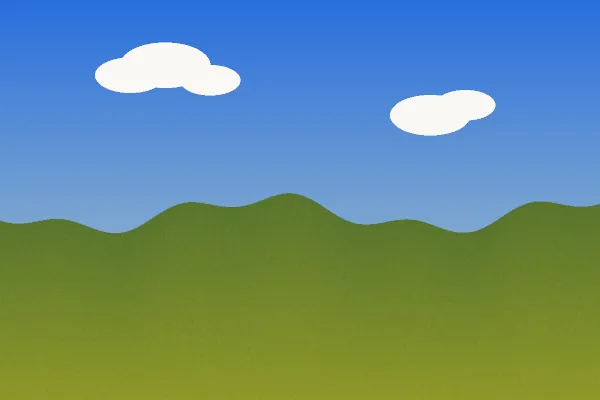

# Demo: photo montage with sky replacement

A landscape under a dull gray sky gets another picture's sky: the old sky is selected by color and
refined, the new sky is masked into place on its own layer, the fields are warmed to the new light by
an editable color balance, and the XCF keeps every step, through MCP only.

```sh
uv run demo/run.py sky-replacement      # scripted version, headless GIMP; report in demo/out/
CLAUDE_CODE_OAUTH_TOKEN=... demo/video/record.sh 0.6.0 sky-replacement   # agent version, video
uv run evals/run.py sky-replacement     # agent version, checked (evaluation suite)
```

| Before | After |
|---|---|
|  |  |

## How

`gimp_select_by_color` from a corner of the sky (contiguous, threshold 24), `gimp_modify_selection_shape`
`grow` 1 px and `feather` 1.5 px, the new sky with `gimp_import_layer` and `gimp_add_layer_mask` from the
selection, then `gimp_color_balance` on the landscape with `destructive: false` (an editable filter),
`gimp_save_image` and `gimp_export_image`.

## What is checked

Both pictures are drawn by code (CC0) with a known horizon, so: above the horizon every sampled pixel
is the new sky's (worst difference 0); below it, the fields changed by the color grade only (at most 40
per channel, and not zero); three pixels above the horizon nothing is the old gray, three below nothing
is sky (a transition narrower than 6 px); the reopened XCF keeps the color balance as an editable filter,
and its structure (read from the file) has the new sky as a masked layer over the landscape. The
[generated report](sky-replacement/report.md) lists every call and check.
