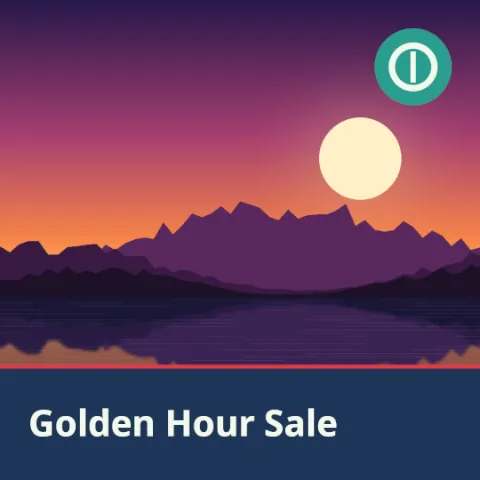
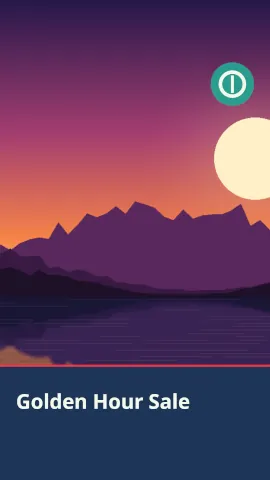
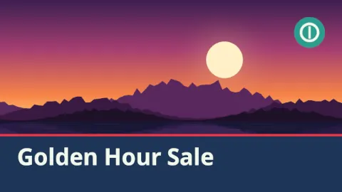

# gimp-mcp demo: social media kit from one design

Result: **PASS** — 33/33 checks, 100 MCP tool calls, 4.3 s.

Outputs: `logo.png`, `social-post.xcf`, `social-post.png`, `social-story.xcf`, `social-story.png`, `social-banner.xcf`, `social-banner.png`, `social-thumbnail.xcf`, `social-thumbnail.png`.

## Previews (from `gimp_preview`)

**post (1080x1080)**

**story (1080x1920)**

**banner (1500x500)**

**thumbnail (1280x720)**

## Checks

| # | Check | Result | Detail |
|---|---|---|---|
| 1 | post: the headline is editable text, 'Golden Hour Sale' in Sans-serif Bold | pass | 'Golden Hour Sale', Sans-serif Bold |
| 2 | post: guides on the safe area | pass | [('horizontal', 64), ('horizontal', 1016), ('vertical', 64), ('vertical', 1016)] |
| 3 | post: the headline lies inside the safe area | pass | 64,894 952x122 in 64,64-1016,1016 |
| 4 | post: the logo lies inside the safe area | pass | 843,64 173x173 in 64,64-1016,1016 |
| 5 | story: the headline is editable text, 'Golden Hour Sale' in Sans-serif Bold | pass | 'Golden Hour Sale', Sans-serif Bold |
| 6 | story: guides on the safe area | pass | [('horizontal', 250), ('horizontal', 1670), ('vertical', 64), ('vertical', 1016)] |
| 7 | story: the headline lies inside the safe area | pass | 64,1548 952x122 in 64,250-1016,1670 |
| 8 | story: the logo lies inside the safe area | pass | 843,250 173x173 in 64,250-1016,1670 |
| 9 | banner: the headline is editable text, 'Golden Hour Sale' in Sans-serif Bold | pass | 'Golden Hour Sale', Sans-serif Bold |
| 10 | banner: guides on the safe area | pass | [('horizontal', 60), ('horizontal', 440), ('vertical', 60), ('vertical', 1440)] |
| 11 | banner: the headline lies inside the safe area | pass | 60,350 1380x90 in 60,60-1440,440 |
| 12 | banner: the logo lies inside the safe area | pass | 1360,60 80x80 in 60,60-1440,440 |
| 13 | thumbnail: the headline is editable text, 'Golden Hour Sale' in Sans-serif Bold | pass | 'Golden Hour Sale', Sans-serif Bold |
| 14 | thumbnail: guides on the safe area | pass | [('horizontal', 64), ('horizontal', 656), ('vertical', 64), ('vertical', 1216)] |
| 15 | thumbnail: the headline lies inside the safe area | pass | 64,527 1152x129 in 64,64-1216,656 |
| 16 | thumbnail: the logo lies inside the safe area | pass | 1101,64 115x115 in 64,64-1216,656 |
| 17 | social-post.png is 1080x1080 | pass | 1080x1080 |
| 18 | post: the brand colors are there (navy band, cream text, red accent) | pass | navy 21.7%, cream 1.71%, red 0.74% |
| 19 | post: the logo lies inside the safe area | pass | logo (843, 64, 1016, 237), safe 64,64-1016,1016 |
| 20 | social-post.xcf keeps the headline as an editable text layer | pass | 422146 bytes |
| 21 | social-story.png is 1080x1920 | pass | 1080x1920 |
| 22 | story: the brand colors are there (navy band, cream text, red accent) | pass | navy 22.7%, cream 0.96%, red 0.42% |
| 23 | story: the logo lies inside the safe area | pass | logo (843, 250, 1016, 423), safe 64,250-1016,1670 |
| 24 | social-story.xcf keeps the headline as an editable text layer | pass | 902062 bytes |
| 25 | social-banner.png is 1500x500 | pass | 1500x500 |
| 26 | banner: the brand colors are there (navy band, cream text, red accent) | pass | navy 31.9%, cream 1.17%, red 1.60% |
| 27 | banner: the logo lies inside the safe area | pass | logo (1360, 60, 1440, 140), safe 60,60-1440,440 |
| 28 | social-banner.xcf keeps the headline as an editable text layer | pass | 332079 bytes |
| 29 | social-thumbnail.png is 1280x720 | pass | 1280x720 |
| 30 | thumbnail: the brand colors are there (navy band, cream text, red accent) | pass | navy 26.8%, cream 2.11%, red 1.11% |
| 31 | thumbnail: the logo lies inside the safe area | pass | logo (1101, 64, 1216, 179), safe 64,64-1216,656 |
| 32 | social-thumbnail.xcf keeps the headline as an editable text layer | pass | 285549 bytes |
| 33 | the server listed only the scenario's toolsets (39 tools) | pass | files,layers,transform,paint,text,document |

## Tool calls

| # | Tool | Arguments | ms | Result |
|---|---|---|---|---|
| 1 | `gimp_create_image` | `{"width": 1080, "height": 1080, "fill": "#1d3557"}` | 97 | id=image:1@3d637b65, name=[Untitled], width=1080, height=1080 |
| 2 | `gimp_add_guide` | `{"image": "image:1@3d637b65", "orientation": "vertical", "position": 64}` | 8 | ok |
| 3 | `gimp_add_guide` | `{"image": "image:1@3d637b65", "orientation": "vertical", "position": 1016}` | 3 | ok |
| 4 | `gimp_add_guide` | `{"image": "image:1@3d637b65", "orientation": "horizontal", "position": 64}` | 2 | ok |
| 5 | `gimp_add_guide` | `{"image": "image:1@3d637b65", "orientation": "horizontal", "position": 1016}` | 2 | ok |
| 6 | `gimp_import_layer` | `{"image": "image:1@3d637b65", "path": "demo/assets/lake-sunset.png", "name": "Photo"}` | 122 | id=item:5@3d637b65, name=Photo, kind=layer, width=1600, height=1000, x=0, y=0 |
| 7 | `gimp_scale_layer` | `{"item": "item:5@3d637b65", "width": 1728, "height": 1080, "anchor": "top-left"}` | 73 | id=item:5@3d637b65, name=Photo, kind=layer, width=1728, height=1080, x=0, y=0 |
| 8 | `gimp_set_layer_offsets` | `{"item": "item:5@3d637b65", "x": -324, "y": 0}` | 13 | id=item:5@3d637b65, name=Photo, kind=layer, width=1728, height=1080, x=-324, y=0 |
| 9 | `gimp_create_layer` | `{"image": "image:1@3d637b65", "name": "Brand band"}` | 13 | id=item:6@3d637b65, name=Brand band, kind=layer, width=1080, height=1080, x=0, y=0 |
| 10 | `gimp_draw_shape` | `{"item": "item:6@3d637b65", "shape": "rectangle", "x": 0, "y": 821, "width": 1080, "height": 259, "fill_color": "#1d3...` | 34 | changed=True |
| 11 | `gimp_draw_shape` | `{"item": "item:6@3d637b65", "shape": "rectangle", "x": 0, "y": 821, "width": 1080, "height": 8, "fill_color": "#e63946"}` | 16 | changed=True |
| 12 | `gimp_create_text_layer` | `{"image": "image:1@3d637b65", "text": "Golden Hour Sale", "font": "Sans-serif Bold", "size": 81, "color": "#f1faee", ...` | 75 | id=item:7@3d637b65, name=Golden Hour Sale, kind=text, width=952, height=122, x=64, y=894 |
| 13 | `gimp_set_layer_properties` | `{"item": "item:7@3d637b65", "name": "Headline"}` | 10 | id=item:7@3d637b65, name=Headline, kind=text, width=952, height=122, x=64, y=894 |
| 14 | `gimp_import_layer` | `{"image": "image:1@3d637b65", "path": "demo/out/social-media-kit/logo.png", "name"...` | 98 | id=item:10@3d637b65, name=Logo, kind=layer, width=300, height=300, x=0, y=0 |
| 15 | `gimp_scale_layer` | `{"item": "item:10@3d637b65", "width": 173, "height": 173, "anchor": "top-left"}` | 50 | id=item:10@3d637b65, name=Logo, kind=layer, width=173, height=173, x=0, y=0 |
| 16 | `gimp_set_layer_offsets` | `{"item": "item:10@3d637b65", "x": 843, "y": 64}` | 3 | id=item:10@3d637b65, name=Logo, kind=layer, width=173, height=173, x=843, y=64 |
| 17 | `gimp_preview` | `{"image": "image:1@3d637b65", "max_size": 480}` | 38 | 480x480 PNG, 49041 bytes |
| 18 | `gimp_save_image` | `{"image": "image:1@3d637b65", "path": "demo/out/social-media-kit/social-post.xcf",...` | 26 | bytes=422146 |
| 19 | `gimp_export_image` | `{"image": "image:1@3d637b65", "path": "demo/out/social-media-kit/social-post.png",...` | 221 | width=1080, height=1080, path=demo/out/social-media-kit/social-post.png, bytes=106658 |
| 20 | `gimp_close_image` | `{"image": "image:1@3d637b65"}` | 5 | ok |
| 21 | `gimp_open_image` | `{"path": "demo/out/social-media-kit/social-post.xcf"}` | 25 | id=image:5@3d637b65, name=social-post.xcf, width=1080, height=1080 |
| 22 | `gimp_inspect_image` | `{"image": "image:5@3d637b65"}` | 25 | id=image:5@3d637b65, name=social-post.xcf, width=1080, height=1080 |
| 23 | `gimp_inspect_text` | `{"item": "item:31@3d637b65"}` | 5 | width=952, height=122, x=64, y=894 |
| 24 | `gimp_list_guides` | `{"image": "image:5@3d637b65"}` | 6 | ok |
| 25 | `gimp_close_image` | `{"image": "image:5@3d637b65"}` | 5 | ok |
| 26 | `gimp_create_image` | `{"width": 1080, "height": 1920, "fill": "#1d3557"}` | 6 | id=image:6@3d637b65, name=[Untitled], width=1080, height=1920 |
| 27 | `gimp_add_guide` | `{"image": "image:6@3d637b65", "orientation": "vertical", "position": 64}` | 3 | ok |
| 28 | `gimp_add_guide` | `{"image": "image:6@3d637b65", "orientation": "vertical", "position": 1016}` | 2 | ok |
| 29 | `gimp_add_guide` | `{"image": "image:6@3d637b65", "orientation": "horizontal", "position": 250}` | 2 | ok |
| 30 | `gimp_add_guide` | `{"image": "image:6@3d637b65", "orientation": "horizontal", "position": 1670}` | 2 | ok |
| 31 | `gimp_import_layer` | `{"image": "image:6@3d637b65", "path": "demo/assets/lake-sunset.png", "name": "Photo"}` | 110 | id=item:40@3d637b65, name=Photo, kind=layer, width=1600, height=1000, x=0, y=0 |
| 32 | `gimp_scale_layer` | `{"item": "item:40@3d637b65", "width": 3072, "height": 1920, "anchor": "top-left"}` | 111 | id=item:40@3d637b65, name=Photo, kind=layer, width=3072, height=1920, x=0, y=0 |
| 33 | `gimp_set_layer_offsets` | `{"item": "item:40@3d637b65", "x": -996, "y": 0}` | 9 | id=item:40@3d637b65, name=Photo, kind=layer, width=3072, height=1920, x=-996, y=0 |
| 34 | `gimp_create_layer` | `{"image": "image:6@3d637b65", "name": "Brand band"}` | 13 | id=item:41@3d637b65, name=Brand band, kind=layer, width=1080, height=1920, x=0, y=0 |
| 35 | `gimp_draw_shape` | `{"item": "item:41@3d637b65", "shape": "rectangle", "x": 0, "y": 1459, "width": 1080, "height": 461, "fill_color": "#1...` | 38 | changed=True |
| 36 | `gimp_draw_shape` | `{"item": "item:41@3d637b65", "shape": "rectangle", "x": 0, "y": 1459, "width": 1080, "height": 8, "fill_color": "#e63...` | 19 | changed=True |
| 37 | `gimp_create_text_layer` | `{"image": "image:6@3d637b65", "text": "Golden Hour Sale", "font": "Sans-serif Bold", "size": 81, "color": "#f1faee", ...` | 27 | id=item:42@3d637b65, name=Golden Hour Sale, kind=text, width=952, height=122, x=64, y=1548 |
| 38 | `gimp_set_layer_properties` | `{"item": "item:42@3d637b65", "name": "Headline"}` | 8 | id=item:42@3d637b65, name=Headline, kind=text, width=952, height=122, x=64, y=1548 |
| 39 | `gimp_import_layer` | `{"image": "image:6@3d637b65", "path": "demo/out/social-media-kit/logo.png", "name"...` | 103 | id=item:45@3d637b65, name=Logo, kind=layer, width=300, height=300, x=0, y=0 |
| 40 | `gimp_scale_layer` | `{"item": "item:45@3d637b65", "width": 173, "height": 173, "anchor": "top-left"}` | 13 | id=item:45@3d637b65, name=Logo, kind=layer, width=173, height=173, x=0, y=0 |
| 41 | `gimp_set_layer_offsets` | `{"item": "item:45@3d637b65", "x": 843, "y": 250}` | 5 | id=item:45@3d637b65, name=Logo, kind=layer, width=173, height=173, x=843, y=250 |
| 42 | `gimp_preview` | `{"image": "image:6@3d637b65", "max_size": 480}` | 12 | 270x480 PNG, 22758 bytes |
| 43 | `gimp_save_image` | `{"image": "image:6@3d637b65", "path": "demo/out/social-media-kit/social-story.xcf"...` | 32 | bytes=902062 |
| 44 | `gimp_export_image` | `{"image": "image:6@3d637b65", "path": "demo/out/social-media-kit/social-story.png"...` | 253 | width=1080, height=1920, path=demo/out/social-media-kit/social-story.png, bytes=117500 |
| 45 | `gimp_close_image` | `{"image": "image:6@3d637b65"}` | 6 | ok |
| 46 | `gimp_open_image` | `{"path": "demo/out/social-media-kit/social-story.xcf"}` | 39 | id=image:10@3d637b65, name=social-story.xcf, width=1080, height=1920 |
| 47 | `gimp_inspect_image` | `{"image": "image:10@3d637b65"}` | 20 | id=image:10@3d637b65, name=social-story.xcf, width=1080, height=1920 |
| 48 | `gimp_inspect_text` | `{"item": "item:66@3d637b65"}` | 2 | width=952, height=122, x=64, y=1548 |
| 49 | `gimp_list_guides` | `{"image": "image:10@3d637b65"}` | 2 | ok |
| 50 | `gimp_close_image` | `{"image": "image:10@3d637b65"}` | 4 | ok |
| 51 | `gimp_create_image` | `{"width": 1500, "height": 500, "fill": "#1d3557"}` | 6 | id=image:11@3d637b65, name=[Untitled], width=1500, height=500 |
| 52 | `gimp_add_guide` | `{"image": "image:11@3d637b65", "orientation": "vertical", "position": 60}` | 3 | ok |
| 53 | `gimp_add_guide` | `{"image": "image:11@3d637b65", "orientation": "vertical", "position": 1440}` | 2 | ok |
| 54 | `gimp_add_guide` | `{"image": "image:11@3d637b65", "orientation": "horizontal", "position": 60}` | 2 | ok |
| 55 | `gimp_add_guide` | `{"image": "image:11@3d637b65", "orientation": "horizontal", "position": 440}` | 2 | ok |
| 56 | `gimp_import_layer` | `{"image": "image:11@3d637b65", "path": "demo/assets/lake-sunset.png", "name": "Pho...` | 104 | id=item:75@3d637b65, name=Photo, kind=layer, width=1600, height=1000, x=0, y=0 |
| 57 | `gimp_scale_layer` | `{"item": "item:75@3d637b65", "width": 1500, "height": 938, "anchor": "top-left"}` | 43 | id=item:75@3d637b65, name=Photo, kind=layer, width=1500, height=938, x=0, y=0 |
| 58 | `gimp_set_layer_offsets` | `{"item": "item:75@3d637b65", "x": 0, "y": -219}` | 3 | id=item:75@3d637b65, name=Photo, kind=layer, width=1500, height=938, x=0, y=-219 |
| 59 | `gimp_create_layer` | `{"image": "image:11@3d637b65", "name": "Brand band"}` | 6 | id=item:76@3d637b65, name=Brand band, kind=layer, width=1500, height=500, x=0, y=0 |
| 60 | `gimp_draw_shape` | `{"item": "item:76@3d637b65", "shape": "rectangle", "x": 0, "y": 326, "width": 1500, "height": 174, "fill_color": "#1d...` | 22 | changed=True |
| 61 | `gimp_draw_shape` | `{"item": "item:76@3d637b65", "shape": "rectangle", "x": 0, "y": 326, "width": 1500, "height": 8, "fill_color": "#e639...` | 10 | changed=True |
| 62 | `gimp_create_text_layer` | `{"image": "image:11@3d637b65", "text": "Golden Hour Sale", "font": "Sans-serif Bold", "size": 60, "color": "#f1faee",...` | 15 | id=item:77@3d637b65, name=Golden Hour Sale, kind=text, width=1380, height=90, x=60, y=350 |
| 63 | `gimp_set_layer_properties` | `{"item": "item:77@3d637b65", "name": "Headline"}` | 2 | id=item:77@3d637b65, name=Headline, kind=text, width=1380, height=90, x=60, y=350 |
| 64 | `gimp_import_layer` | `{"image": "image:11@3d637b65", "path": "demo/out/social-media-kit/logo.png", "name...` | 91 | id=item:80@3d637b65, name=Logo, kind=layer, width=300, height=300, x=0, y=0 |
| 65 | `gimp_scale_layer` | `{"item": "item:80@3d637b65", "width": 80, "height": 80, "anchor": "top-left"}` | 14 | id=item:80@3d637b65, name=Logo, kind=layer, width=80, height=80, x=0, y=0 |
| 66 | `gimp_set_layer_offsets` | `{"item": "item:80@3d637b65", "x": 1360, "y": 60}` | 4 | id=item:80@3d637b65, name=Logo, kind=layer, width=80, height=80, x=1360, y=60 |
| 67 | `gimp_preview` | `{"image": "image:11@3d637b65", "max_size": 480}` | 8 | 480x160 PNG, 17970 bytes |
| 68 | `gimp_save_image` | `{"image": "image:11@3d637b65", "path": "demo/out/social-media-kit/social-banner.xc...` | 18 | bytes=332079 |
| 69 | `gimp_export_image` | `{"image": "image:11@3d637b65", "path": "demo/out/social-media-kit/social-banner.pn...` | 163 | width=1500, height=500, path=demo/out/social-media-kit/social-banner.png, bytes=57570 |
| 70 | `gimp_close_image` | `{"image": "image:11@3d637b65"}` | 5 | ok |
| 71 | `gimp_open_image` | `{"path": "demo/out/social-media-kit/social-banner.xcf"}` | 19 | id=image:15@3d637b65, name=social-banner.xcf, width=1500, height=500 |
| 72 | `gimp_inspect_image` | `{"image": "image:15@3d637b65"}` | 16 | id=image:15@3d637b65, name=social-banner.xcf, width=1500, height=500 |
| 73 | `gimp_inspect_text` | `{"item": "item:101@3d637b65"}` | 3 | width=1380, height=90, x=60, y=350 |
| 74 | `gimp_list_guides` | `{"image": "image:15@3d637b65"}` | 2 | ok |
| 75 | `gimp_close_image` | `{"image": "image:15@3d637b65"}` | 4 | ok |
| 76 | `gimp_create_image` | `{"width": 1280, "height": 720, "fill": "#1d3557"}` | 7 | id=image:16@3d637b65, name=[Untitled], width=1280, height=720 |
| 77 | `gimp_add_guide` | `{"image": "image:16@3d637b65", "orientation": "vertical", "position": 64}` | 7 | ok |
| 78 | `gimp_add_guide` | `{"image": "image:16@3d637b65", "orientation": "vertical", "position": 1216}` | 2 | ok |
| 79 | `gimp_add_guide` | `{"image": "image:16@3d637b65", "orientation": "horizontal", "position": 64}` | 3 | ok |
| 80 | `gimp_add_guide` | `{"image": "image:16@3d637b65", "orientation": "horizontal", "position": 656}` | 2 | ok |
| 81 | `gimp_import_layer` | `{"image": "image:16@3d637b65", "path": "demo/assets/lake-sunset.png", "name": "Pho...` | 98 | id=item:110@3d637b65, name=Photo, kind=layer, width=1600, height=1000, x=0, y=0 |
| 82 | `gimp_scale_layer` | `{"item": "item:110@3d637b65", "width": 1280, "height": 800, "anchor": "top-left"}` | 40 | id=item:110@3d637b65, name=Photo, kind=layer, width=1280, height=800, x=0, y=0 |
| 83 | `gimp_set_layer_offsets` | `{"item": "item:110@3d637b65", "x": 0, "y": -40}` | 6 | id=item:110@3d637b65, name=Photo, kind=layer, width=1280, height=800, x=0, y=-40 |
| 84 | `gimp_create_layer` | `{"image": "image:16@3d637b65", "name": "Brand band"}` | 6 | id=item:111@3d637b65, name=Brand band, kind=layer, width=1280, height=720, x=0, y=0 |
| 85 | `gimp_draw_shape` | `{"item": "item:111@3d637b65", "shape": "rectangle", "x": 0, "y": 503, "width": 1280, "height": 217, "fill_color": "#1...` | 28 | changed=True |
| 86 | `gimp_draw_shape` | `{"item": "item:111@3d637b65", "shape": "rectangle", "x": 0, "y": 503, "width": 1280, "height": 8, "fill_color": "#e63...` | 12 | changed=True |
| 87 | `gimp_create_text_layer` | `{"image": "image:16@3d637b65", "text": "Golden Hour Sale", "font": "Sans-serif Bold", "size": 86, "color": "#f1faee",...` | 19 | id=item:112@3d637b65, name=Golden Hour Sale, kind=text, width=1152, height=129, x=64, y=527 |
| 88 | `gimp_set_layer_properties` | `{"item": "item:112@3d637b65", "name": "Headline"}` | 5 | id=item:112@3d637b65, name=Headline, kind=text, width=1152, height=129, x=64, y=527 |
| 89 | `gimp_import_layer` | `{"image": "image:16@3d637b65", "path": "demo/out/social-media-kit/logo.png", "name...` | 213 | id=item:115@3d637b65, name=Logo, kind=layer, width=300, height=300, x=0, y=0 |
| 90 | `gimp_scale_layer` | `{"item": "item:115@3d637b65", "width": 115, "height": 115, "anchor": "top-left"}` | 17 | id=item:115@3d637b65, name=Logo, kind=layer, width=115, height=115, x=0, y=0 |
| 91 | `gimp_set_layer_offsets` | `{"item": "item:115@3d637b65", "x": 1101, "y": 64}` | 3 | id=item:115@3d637b65, name=Logo, kind=layer, width=115, height=115, x=1101, y=64 |
| 92 | `gimp_preview` | `{"image": "image:16@3d637b65", "max_size": 480}` | 11 | 480x270 PNG, 29961 bytes |
| 93 | `gimp_save_image` | `{"image": "image:16@3d637b65", "path": "demo/out/social-media-kit/social-thumbnail...` | 17 | bytes=285549 |
| 94 | `gimp_export_image` | `{"image": "image:16@3d637b65", "path": "demo/out/social-media-kit/social-thumbnail...` | 243 | width=1280, height=720, path=demo/out/social-media-kit/social-thumbnail.png, bytes=74139 |
| 95 | `gimp_close_image` | `{"image": "image:16@3d637b65"}` | 7 | ok |
| 96 | `gimp_open_image` | `{"path": "demo/out/social-media-kit/social-thumbnail.xcf"}` | 27 | id=image:20@3d637b65, name=social-thumbnail.xcf, width=1280, height=720 |
| 97 | `gimp_inspect_image` | `{"image": "image:20@3d637b65"}` | 17 | id=image:20@3d637b65, name=social-thumbnail.xcf, width=1280, height=720 |
| 98 | `gimp_inspect_text` | `{"item": "item:136@3d637b65"}` | 3 | width=1152, height=129, x=64, y=527 |
| 99 | `gimp_list_guides` | `{"image": "image:20@3d637b65"}` | 2 | ok |
| 100 | `gimp_close_image` | `{"image": "image:20@3d637b65"}` | 5 | ok |
